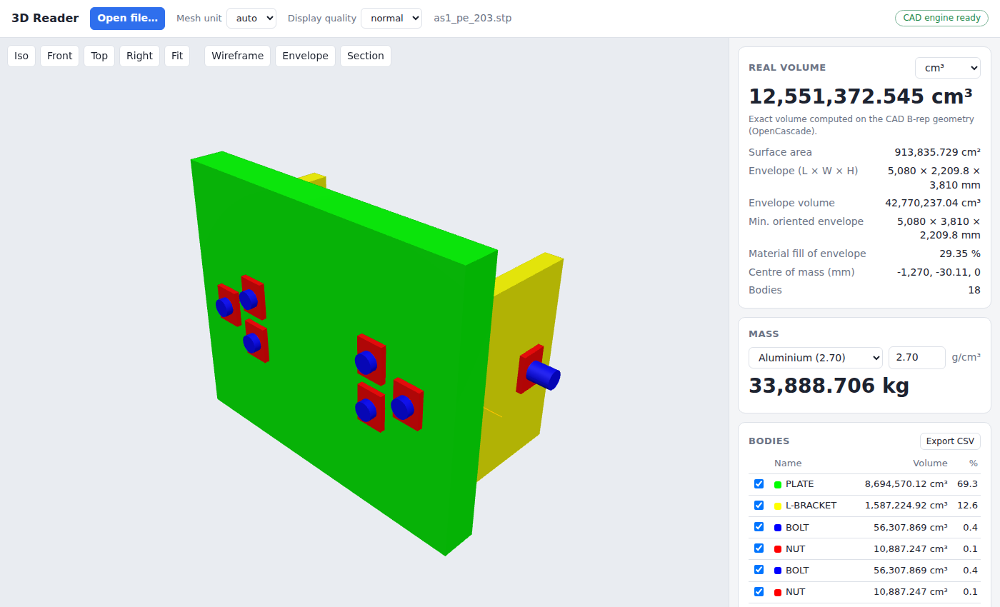

# 3D Reader

A web application that opens 3D files (STEP and most other 3D formats), shows them
in the browser, and computes the **real volume of material** of each part, not only
the bounding envelope ("encombrement").

**Online version** (once published, see [Publishing on GitHub Pages](#publishing-on-github-pages)):
https://alexdevanssay-cmyk.github.io/3D-reader/



## Features

- **Formats**
  - CAD (exact geometry, via OpenCascade): **STEP** (`.step`, `.stp`), **IGES** (`.iges`, `.igs`), **BREP**
  - Meshes: **STL**, **OBJ**, **PLY**, **OFF**, **glTF/GLB**, **3MF**, **DAE**
- **Real volume**
  - STEP/IGES/BREP: exact volume integrated over the true B-rep surfaces (planes,
    cylinders, NURBS...) with OpenCascade `BRepGProp`. It does not depend on the
    display tessellation. The volume of the display mesh is also given for comparison.
  - Meshes: volume enclosed by the closed triangle surface (divergence theorem).
    Inverted normals and inconsistent winding are repaired. Open meshes are flagged.
    When the holes are small enough to fill, the volume is given as an estimate.
  - Surface models (STEP/IGES without solids, even with one part per face) are sewn
    into solids when they close.
- **Envelope**: axis-aligned bounding box (L × W × H and its volume), the minimum
  oriented bounding box, and the **fill ratio** (material volume ÷ envelope volume).
- Surface area, centre of mass, and **mass** from a material density (preset list or custom).
- **Wall thickness** for casting design ("épaisseur de toile"), button *Thickness*: colour
  scale of the thickness (switchable), histogram of the surface per thickness over a
  graduated scale, and a cursor that highlights the zones of one thickness (± a tolerance).
  Two methods: *inscribed sphere* (diameter of the largest ball in the material, which
  shows the hot spots at wall junctions) and *ray* (distance to the opposite wall).
- **Parting line** ("plan de joint") of cast parts, card *Plan de joint*: the draw direction
  proposed from the geometry (candidates: dominant face normals, the frame axes, the
  principal axes; ranked by undercut area, then a planar line, then the faces without
  draft), each face classified by lines of sight along the direction (upper half, lower
  half, undercut for a core or slide), and the parting line, planar or stepped/warped with
  its height range. Shown on the 3D view: the parting line as a thick red line drawn over
  everything, the undercuts in yellow, the other faces in light grey (lighter without
  draft), and the two halves of the mould ("chapes") as translucent blocks round the part,
  the upper one blue and the lower one green, a margin of the larger of 5 mm and 15 % of
  the part round it (*Mould halves* hides them). The blocks meet flat at the level of a
  planar line; for a stepped or warped line, on a surface interpolated from the points of
  the line (a height field of at most 48 × 48 cells, inverse distance weighting), so the
  interface follows the line near it and goes from one level to the other between its
  runs. While the parting line or the risers of a body are shown, the other bodies of the
  model are faded and a click goes through them: it reaches the card's body behind another
  one (two versions of a part), never through a body drawn opaque. Another candidate, the
  normal of a face, a typed direction, or faces moved by a click to the upper or lower half
  define it by hand (kept per part in the browser). The semantic contract, the foundry
  screen and the AI context carry it, marked proposed or manual.
  See [Parting line drawn by hand](#parting-line-drawn-by-hand).
- **Parting line drawn by hand** (*Dessin manuel* in the card): a plane is chosen (X, Y, Z,
  a normal typed, or a face clicked); its normal through the centre of the part is the
  rotation axis and the draw direction. Two large arrows on the 3D view turn the part about
  it by 1/4, 1/8, 1/16 or 1/32 of a turn (the step in a frame at the bottom right) without
  leaving the drawing; points are clicked on the part, each joined to the one before by a
  line laid on its surface; clicking point 1 closes the loop and ends the placing. The
  segments are listed (1-2, 2-3 …), each *droit* or *courbe* (an arc: its radius typed,
  its centre typed or clicked). The two parts of the surface go to the halves by part
  ("Partie supérieure" / "Partie inférieure", then a click on that part), never by face.

## Parting line drawn by hand

`web/engine/parting-draw.js` (pure geometry, tested in node) and the block "drawing by
hand" of `web/app.js`:

- **Axis and turn.** The plane's normal through the centre of the body's box is the
  rotation axis, and the draw direction of the line drawn (+axis: the upper half). On
  entering, the view turns to the side (axis upright on the screen, the camera 20° above
  the plane). The arrows (or ← →) turn the camera, the key light and the target the other
  way about that axis, exactly from the pose where the turn started (four quarter turns
  come back to it); the model, the section and the overlays stay in their frame. While
  drawing, the view has no inertia (precise); it comes back on leaving.
- **Straight segment ("droit")**: the slice of the display mesh by a plane through the two
  points, walked from triangle to triangle (exact per triangle): first the plane through
  them closest to square to the axis (points at one height stay at it round corners,
  cylinders and drafted walls: a loop clicked at one height is planar), else the normal
  section (two points on one face: the straight line between them), else those planes
  turned about the chord; the shorter way round, the plane and the side found kept with the
  segment ("⇄" takes it round the other side). No plane from one point to the other (a
  hole between them): along the edges of the mesh (A*, "≈").
- **Curved segment ("courbe")**: a minor circular arc, radius R ≥ half the chord (60° by
  default, in the plane of the segment's line: a rise or a dip of the line on a wall round
  the part, a rounded corner on a face square to the axis), its centre on the bisector
  plane of the chord (typed or clicked: moved onto it), draped on the surface along the
  normal of its plane.
- **Closing, editing**: the loop's first point clicked (or *Fermer la boucle*, Enter) closes
  the loop and ends the placing; *Nouvelle boucle* draws another one (a bore through the parting plane
  needs its own: the outer loop alone does not split the part). Points are dragged,
  deleted (Suppr), added in the middle of a segment ("+"); undo and redo (Ctrl+Z, Ctrl+Y);
  *Aligner* moves the points of a loop to one height typed in (hand-placed points are never
  exactly level), its line then planar.
- **Halves**: the loops cut the surface into parts (union-find of its vertices, the edges
  crossed by a loop as barriers); the parts are proposed to the halves by what each one
  can form (the lines of sight of the axis), then chosen by a click on a part (another
  axis proposes them again: the parts chosen along the one before are forgotten); a passage
  formed by neither half (a core) is left out when it would join them. Undercuts: the
  faces a half cannot form, or of no half. The drawn line is applied as any definition by
  hand (red line, yellow undercuts, blocks, risers placed again) and kept per part in the
  browser, as is a drawing not finished (a draft). Halves are per triangle: on a coarse
  mesh their boundary zigzags by a triangle along the line (the line itself is exact; the
  area of the triangles it crosses is exported as `seam_area_mm2`).
- **Slides** ("tiroirs"), part *Tiroirs et noyaux* of the parting line card: the undercuts
  of the definition shown (proposed, chosen, reassigned or drawn by hand) grouped into
  zones, each tested by lines of sight along the lateral directions that could pull a
  slide out of it (in the parting plane or tilted up to 45°), and the zones grouped into
  slides, one per pull direction ("direction de sortie"), with the stroke ("course",
  depth along the pull + 5 mm) and the size of each; the probable cores (what no slide
  releases, a closed cavity), the zones a half could form (to rework at the parting line)
  and the markings under 1.5 mm deep apart. Each slide in a colour of its own on the 3D
  view (the first one in the yellow of the undercuts) with an arrow along its pull
  direction (*Tiroirs* turns them off). Zones are moved to another slide, made cores or
  ignored by a click, slides merged or turned to another direction that releases all
  their zones; kept per part in the browser (and carried over to another definition of
  the same draw direction). The count is proposed to « Tiroirs du moule » of the costing.
  See [Slides: method and limits](#slides-method-and-limits).
- **Risers and gating** ("masselottes et attaque de coulée"), card *Masselottes et attaque
  de coulée*: the hot spots and the feeding zones read from the inscribed spheres, a riser
  proposed on each zone no other one can feed (where, open on top or blind on the side,
  D × H, volume and mass), the ingate on the parting line (position, section, why), the
  casting yield. Shown on the 3D view; risers added, moved, resized or deleted and the
  ingate placed by a click (kept per part in the browser). See
  [Risers and gating](#risers-and-gating-method-and-limits).
- **Through and blind holes** of CAD solids, measured on the geometry: each hole (a
  cylinder with the material around it, with its counterbore, countersink or drill point)
  is probed by lines cast along its axis on the closed mesh: open at both ends, a through
  hole; closed by a bottom at one, a blind hole, with its depth (from the furthest point
  of its opening) and bottom (flat, drill point). A rounded edge into a cavity still
  opens; a hole cut in two by a cross bore is one hole; the outside of a boss or a tube
  round a hole is none. The semantic contract and the AI context give them as measured
  (`through_hole`, `blind_hole`, operations `drilling` / `drilling_blind`); a hole the
  lines cannot decide stays provisional, with the reason. Mesh files (STL...) have no
  hole candidates.
- Assemblies: one row per part with names and colours from the STEP file, per-part
  volume and share, show/hide, and click a part in 3D to select it.
- Viewer: orbit, pan, zoom, standard views, wireframe, envelope display, section plane
  (the solids it cuts, bodies, risers and ingate, are closed: the cut shows as a solid
  face, a body's darker than its own colour; open bodies, meshes whose triangles had to be
  turned round or held duplicates, and the mould halves stay open).
- Side panel of the 3D view, condensed at will: each card folds to its title (its chevron,
  a click on the title, or « Tout replier / Tout déplier »), its head's controls still at
  hand and its key value (volume, mass, thinnest wall) beside the title; the panel's width
  set by dragging the edge between the view and it (from 260 px to 60 % of the window;
  arrow keys too, a double-click for the default width). Both are kept in the browser.
- **Costing of cast parts** (tabs *Chiffrage* and *Paramètres*, in French): import the
  SAB costing workbook (.xlsm) and the metal prices file (sheet « Suivi indice »); the
  page recomputes the hourly costs of the profit centres and the cost price (PRI) and
  sale price of the part like the workbook does, proposes the three best manufacturing
  routes (casting island × finishing) by quality / price from the geometry of the 3D model
  (weight, thinnest wall, hot spots, modulus, size), and exports the quote to Excel.
  Casting parameters are drop-down lists; TRS, islands and methods are settings kept in
  the browser. The workbooks are read in the browser and never published. A history of
  cycle times (past quotes, and times measured in production typed in for the part shown)
  is kept in the browser too, imported and exported as JSON, and compared with the
  cycle-time formula of the settings. The casting cycle time can also be estimated by
  the AI of the page *IA / analyse* (the gateway, or a local Ollama), from the geometry,
  the formula, the trend and the similar parts of the history: a proposal, shown with
  its breakdown and range, used in the quote only when the user clicks « Utiliser cette
  valeur » (then traced as « estimation IA validée »). « Banc d'essai IA » backtests that
  estimate on the history (each record left out of its own similar parts) against the
  formula: mean errors by island and source, paced for the free quota of the gateway,
  resumable, exported as CSV. Under « Tiroirs du moule » of an in-house die, the slides
  of the 3D analysis (per part × the cavities of the die) are proposed with « Utiliser N
  tiroirs »: used only by that click (traced « analyse 3D validée »), a value typed is
  never replaced, and a change of the parting line, of the slides or of the cavities
  since is shown with the value kept.
- **Shared network folder** (Chrome or Edge; chosen once per PC in *Paramètres*): a
  folder of the company network where every PC writes, and reads, the results of its 3D
  analyses (`analyses-3d`: a part analysed on one PC opens at once on another, wall
  thickness included), the cycle times measured in production (`retours-experience`,
  merged into the history, the newer record of a reference winning) and the
  conversations of the IA page (`historique-ia`). Nothing goes anywhere else.
- Export of the results to **Excel** (.xlsx, one value per cell: a row per body, a
  column per quantity, plus a summary sheet), CSV (`;` and decimal comma in French)
  and JSON.
- Interface in **English or French** (button in the top bar, or `?lang=fr`).
- Progress of the analysis in percent, updated live during each step (reading,
  conversion, meshing, volumes: measured from the work OpenCascade does), and a **memory gauge** (criticality in %, memory
  of the CAD engine, of the page and of the device) that warns before a file that could
  make the browser stop the page; the CAD engine gives its memory back after a large file.
- **AI assistants and scripts** can use the online reader by link
  (`?url=<model URL>&report=1`), through `window.reader3d.analyze()` in the page, or
  with the Python package: see [web/ai.html](web/ai.html) (published at `/ai.html`).
- Units: everything is reported in mm / mm² / mm³ (switchable to cm³, dm³, m³, in³).
  CAD files are converted from their own unit automatically. Mesh files have no unit,
  so choose it (auto = mm, or metres for glTF, or the unit stored in 3MF/DAE).

## Slides: method and limits

`web/engine/slides.js` groups the undercuts of the parting definition shown for a body
into slides, in a worker of its own (`slideworker.js`, which keeps the last body's mesh
and hierarchy: another definition of the same body only casts its lines); never kept with
the results of the file, recomputed in seconds:

- **Zones.** The undercut triangles (those painted yellow) joined by a vertex are regions;
  each is tested along one pool of at most 64 directions: the axes of the die in the
  parting plane and a 15° sweep between them, the frame axes, the mean normal and the axis
  of each region, up to 45° out of the plane (« incliné » from 1°). A point of it frees
  along a direction when a line of sight from it meets nothing (a face turned against the
  pull would be dragged: never). A direction freeing 95 % of a region makes it one zone;
  else a cover by triangle splits it between at most 4 directions (a groove round a
  column: two half shells), and a region covered less than 80 % is a probable core.
- **Kinds.** A zone shallower than 1.5 mm along its pulls and under 2 % of the surface is
  a marking, ignored; one a half could form, that no slide in the plane forms with draft,
  is to rework at the parting line (a stepped line, faces reassigned); the others are slide
  zones.
- **Slides.** The direction releasing the most zones takes them all, until none is left;
  stroke = the zone's extent along the pull + 5 mm (conservative for half shells), size =
  its face across the pull; tags « petit : usinage ? » (under 6 × 6 mm), « course
  longue » (over 120 mm), « une chape pourrait la former ». More than 4 slides, or
  undercuts over 30 % of the surface: a warning, nothing truncated. The 128 largest
  regions are analysed, the others listed and left yellow.
- **The same input gives the same result**: fixed seeds, points drawn by area, every tie
  ruled; the lines cast are bounded whatever the size of the mesh.

Limits: an aid, not a die design. The stroke is not priced; the slides' own draft and
their room in the die are not checked; the probable cores give no core mass nor core box
to the costing (the box « Noyaux sable » is never ticked from here). The count goes to
« Tiroirs du moule » only by « Utiliser » on the Chiffrage page.

## Risers and gating: method and limits

`web/engine/feeding.js` proposes where to feed a cast part (gravity die or sand) from its
closed mesh, in a worker after the analysis (`feedworker.js`), kept with the results; the
risers and the ingate are placed for the parting line shown in a second worker of it:

- **Feeding zones.** The local section is the diameter *D* of the largest sphere inscribed
  at each triangle (the "inscribed sphere" of the wall thickness). A watershed of *D* from
  the thickest triangles down cuts the surface into zones; where two zones meet is the
  thickest way between them (the neck). Directional solidification: a section is fed
  through another only if the path to the feeder does not get thinner, so two zones whose
  neck is under 0.9 × the hot spot of the smaller one solidify apart and each needs its own
  riser; else they are one zone. Zones whose hot-spot balls overlap (one mass of metal cut
  by the surface: a boss on a plate) are one. Above 200 000 triangles, the spheres of
  60 000 triangles drawn by area (fixed seed) are spread to the others.
- **Modulus** (Chvorinov: solidification time ∝ (V/A)²) of a zone: the larger of V/A (its
  surface, its share of the body's volume) and *D*/5 for its hot spot (a cylinder *D* × *D*
  joined by one end: between the ball, *D*/6, and the long bar, *D*/4; heuristic).
- **Risers**: a cylinder H = 1.5 D whose modulus, its contact face excluded (M = 3D/14), is
  at least 1.2 × the zone's (Wlodawer); open on top over the hot spot (on a face of it
  turned up, its footprint held by the part, along the draw direction, +Z without a parting
  line), or blind on the side at the parting line when the hot spot is closer to the joint
  (beside the part, both its ends cool: M = 3D/16).
  Zones under 1 % of the volume get none (a local cooling or a chill); 8 risers at most,
  the largest moduli first, the zones left listed as hot spots without a riser.
- **Ingate**: on the outer outline of the parting line, not next to an undercut, the lowest
  along the draw direction (bottom filling), not under a riser, in the thickest wall
  there, by the shortest way into the part; thickness 0.7 × that wall, width 3 × the
  thickness (heuristics). The yield part / (part + risers + ingate) is for information:
  the sprue and runners are not designed.

Limits: an aid to the running and feeding system, not a simulation of filling or
solidification (no alloy, temperatures, die cooling, feeding distances, chills, insulating
sleeves, nor low-pressure feeding through the ingate); the thresholds are documented
heuristics or textbook factors, to be confirmed with the foundry or a simulation. The
foundry screen marks risering and gating "proposed" or "placed_manually", never sized by
a solver, and flags a hot spot left without a riser.

## Two engines, same results

| | Online version (GitHub Pages) | Python version |
|---|---|---|
| Where it runs | in the visitor's browser (WebAssembly) | on your machine / a server |
| CAD engine | OpenCascade compiled to WebAssembly (`opencascade.js`) | OpenCascade (`cadquery-ocp`) |
| Mesh engine | three.js loaders + `web/engine/meshanalysis.js` | trimesh |
| Install | nothing, open the URL | Python 3.11 or newer |
| Your files | never leave the browser | uploaded to the server you run |
| Extras | — | command line, HTTP API, `.zae`, `.3dxml` |

GitHub Pages only serves static files and cannot run Python, which is why the online
version computes in the browser. Both engines use OpenCascade's exact B-rep integration
for CAD files, and the test suite checks that they give the same numbers on the same
files (`tests/make_fixtures.py` writes the reference results of the Python engine, the
JavaScript tests compare against them).

The first STEP/IGES file opened online downloads the CAD engine (about 14 MB, then
cached by the browser). Mesh files do not need it.

## Python version

### Installation

On Linux without a desktop (servers, Docker slim images, WSL), install the OpenGL
runtime OpenCascade links against first: `sudo apt-get install libgl1` (Debian/Ubuntu)
or `sudo dnf install mesa-libGL` (Fedora).

```bash
python -m venv .venv
source .venv/bin/activate        # Windows: .venv\Scripts\activate
pip install -r requirements.txt
```

### Web interface

```bash
python -m reader3d serve           # then open http://127.0.0.1:8000
python -m reader3d serve --host 0.0.0.0 --port 8080   # reachable from the network
```

Drop a file in the window, or use **Open file…**. When the browser engine is also
available (after `npm ci && npm run vendor`), an **Engine** selector lets you choose
between the Python server and the browser.

### GitHub Codespaces

The repository contains a dev container: **Code → Codespaces → Create codespace** on
GitHub installs everything and starts the Python server; the forwarded port 8000 opens
the app in a URL like `https://<codespace>-8000.app.github.dev`. A codespace stops
after a period of inactivity, so use GitHub Pages for a permanent URL.

### Command line

Installable as a package (`pip install "git+https://github.com/alexdevanssay-cmyk/3D-reader"`
gives a `reader3d` command), or from a checkout:

```bash
python -m reader3d analyze part.step
python -m reader3d analyze scan.stl --unit cm
python -m reader3d analyze part.step --json     # full result as JSON
```

### HTTP API

`POST /api/analyze` (multipart form) with `file`, plus optional `unit`
(`auto|mm|cm|m|in|ft`) and `quality` (`coarse|normal|fine`, display tessellation only).
It returns JSON with a `summary` (total volume, area, envelope, fill ratio, centre of
mass) and `bodies` (per part, including the display mesh as base64 arrays).

## Publishing on GitHub Pages

The workflow `.github/workflows/pages.yml` builds the static site (`npm run build` →
`dist/`) and publishes each commit of `main` once CI (`.github/workflows/ci.yml`: Python
tests, browser engine against the Python results, end-to-end tests) has passed on it.
One-time setup, by the owner of the repository:

1. GitHub Pages on a **private** repository requires a paid plan (Pro, Team or
   Enterprise). On a free account, make the repository public first
   (**Settings → General → Danger Zone → Change visibility**). The published site
   is public either way.
2. **Settings → Pages → Build and deployment → Source: GitHub Actions.**
3. Merge this work into `main`. The deployment then runs after CI; it can also be
   started by hand from the **Actions** tab (**Deploy to GitHub Pages → Run workflow**).
   The URL is shown in the workflow run and under **Settings → Pages**.

Build and preview the static site locally:

```bash
npm ci
npm run build        # writes dist/
npm run serve        # http://127.0.0.1:8080
```

## Project layout

```
reader3d/              Python engine and server
  cad.py               STEP / IGES / BREP reading, exact volumes (OpenCascade)
  mesh.py              mesh formats, closed-mesh volume, repairs (trimesh)
  model.py             result types, totals, bounding boxes
  analyze.py           format dispatch
  server.py            FastAPI app (serves web/ + /api/analyze)
web/                   the web interface (static site)
  app.js               viewer and results panel
  network-folder.js    the shared folder of the company network (File System Access)
  engine/              browser engine
    client.js          main-thread API (mesh parsing, envelopes)
    worker.js          Web Worker running the heavy computations
    occt.js, cad.js    OpenCascade WebAssembly: exact CAD volumes
    meshload.js        mesh formats (three.js loaders)
    meshanalysis.js    closed-mesh volume, repairs
    summary.js         totals, bounding box, minimum oriented box
    thickness.js       wall thickness (inscribed sphere, ray)
    cache.js           results kept in the browser (IndexedDB)
    shared-cache.js    the same results in the shared network folder (gzip container)
    parting.js         draw direction and parting line of cast parts
    parting-draw.js    the parting line drawn by hand (lines laid on the surface, halves by part)
    partworker.js      its worker (partclient.js: main-thread API)
    slides.js          slides (« tiroirs »): the undercuts grouped by pull direction, probable cores
    slideworker.js     its worker (slideclient.js: main-thread API)
    feeding.js         risers and ingate of cast parts (feeding zones, moduli)
    feedworker.js      its worker (feedclient.js: main-thread API)
  chiffrage/           costing pages: workbook reader, cost model, routes, UI
  vendor/              three.js (committed), OpenCascade (generated by npm run vendor)
scripts/               static build and local static server
tests/                 pytest suite, cross-engine fixtures, JS and end-to-end tests
.github/workflows/     CI (all tests) and GitHub Pages deployment
.devcontainer/         GitHub Codespaces configuration
```

## Tests

```bash
pip install -r requirements-dev.txt
pytest                                   # Python engine
python tests/make_fixtures.py            # reference files + Python results
npm ci && npm test                       # browser engine vs Python results
npx playwright install chromium          # once: the browser for the end-to-end tests
npm run build && npm run test:e2e        # the built site in a headless browser
```

The tests build parts with known analytic volumes (a holed block, spheres, cylinders,
STEP written in metres, a surface model, a named and coloured assembly…) and check the
results to 1e-9 relative precision, then check that both engines agree.
